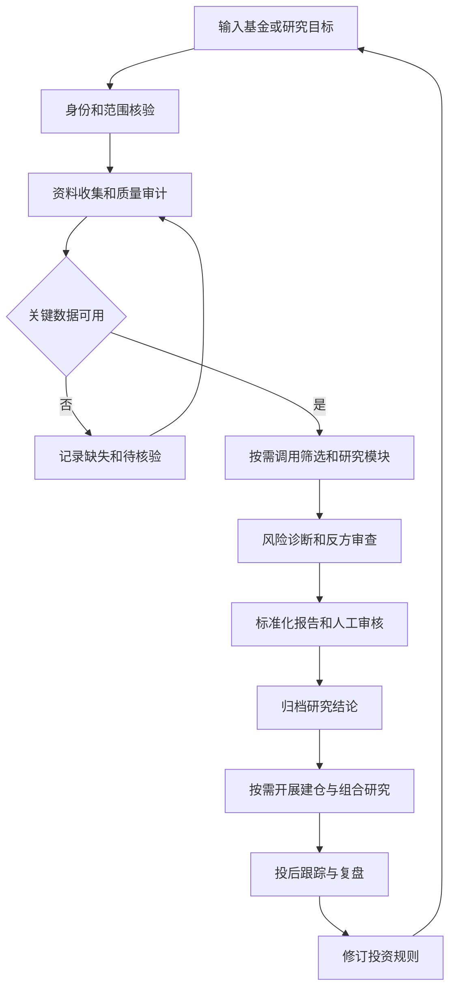

## 项目目的

建立智能体来筛选投资债券基金，和QDII海外投资基金，其他基金不做考虑，完善投资组合。

### Session 1 搭建研究工作台

#### 本节目的

建立统一的个人基金研究工作区、投资原则和 AI 研究规范，使后续每次研究均可重复、核验和归档。

#### 引言

项目的首要任务是研究产品、识别风险和形成可核验的结论。先验证研究流程，再考虑自动化。研究、投资计划和真实交易分别管理；智能体负责信息处理、计算与分析，投资者负责审核和最终决策。

#### 知识点

- **研究范围**：境内外债券基金（包括短债、中长期纯债、国债、投资级及高收益信用债等）；中国大陆可投资的 QDII 海外基金（包括海外宽基、行业、主动股票及海外债券产品）。跨境 ETF 仅在属于 QDII 或债券基金时纳入。其他基金排除；存款、现金和相关指数仅作为流动性安排或比较基准。香港内地互认基金仅在属于债券基金时纳入，不因跨境属性自动归入 QDII。
- **资金原则**：优先考虑本金风险、流动性和长期风险收益；明确资金用途、期限、可接受亏损及风险限制。未提供的个人条件保持待确认；当前学习与研究不要求真实交易。
- **数据原则**：正式基金文件、基金管理人、监管机构、交易所、指数编制机构及官方统计数据优先；可靠专业机构和公开基金数据平台作辅助。禁止使用无机构背书的自媒体作为事实依据。
- **研究纪律**：区分已核实事实、可复现计算、分析推论、情景假设及未知信息；关键数据记录来源、日期、份额、币种与口径；缺失值标记，不编造；主动寻找反方证据。
- **研究状态**：候选（可继续研究）、观察（需补证）、排除（违反范围或已确认硬性条件）。这些是研究状态，交易条件另行核验。

#### 实操步骤

1. 创建统一工作区，保存个人投资说明书.md、全局研究规则、原始资料、研究报告、结构化数据及投资日志。
2. 确认研究范围及个人资金约束，填写个人投资说明书。
3. 将全局研究规则交给 AI，每次调用专项 Prompt 时沿用；以少量产品验证资料来源、分析质量和输出格式。
4. 记录初始研究状态及待核实事项，不要求实际购买基金。

```text
AI基金投资实战课/
├── 01_个人投资说明书/
├── 02_原始基金资料/
├── 03_AI分析报告/
├── 04_基金数据表/
└── 05_投资日志与复盘/
```

以上为研究档案建议，尚未实现软件目录、数据库或 Agent。

#### Prompt 1：个人投资说明书

```text
你现在是我的个人基金研究助理，帮助一名零基础投资者学习中国大陆公募基金。我的投资偏好如下：
研究范围仅为债券基金和QDII海外投资基金，其他基金排除
重视资金安全和流动性。
不追求短期暴利。
目前不执行真实交易。
优先使用免费公开资料和低成本工具。
希望逐步学会独立核验基金数据，而不是盲目接受 AI 推荐。

请完成以下任务。
任务一：建立我的基金研究原则。请把研究原则分为：
• 资金用途和流动性检查。
• 基金产品类型与风险检查。
• 历史收益与回撤检查。
• 基金费用检查。
• 申购、赎回及资金到账规则检查。
• 数据来源与截止日期检查。
• 反方证据和不确定性检查。
任务二：建立 AI 的工作边界。
• 不得编造基金代码、净值、收益率、基金经理或费率。
• 不得仅凭近期收益排名推荐基金。
• 不得把历史收益、低波动或高流动性等同于本金安全。
• 不得把开放式基金等同于随时可取用的银行存款。
• 不得在缺少我的资金用途、投资期限和风险承受能力信息时，给出具体买入金额。
• 对未核实的信息明确标记「待核实」。
• 不得自动执行真实交易。
任务三：建立数据核验表。请使用表格列出以下字段：字段名称、含义、应从哪里核实、数据截止日期、是否必须核验、常见错误。至少覆盖基金名称、基金代码、基金类型、份额类别、基金规模、历史收益、最大回撤、基金经理、管理费、托管费、申购赎回规则、赎回到账时间。
任务四：建立研究结论模板。结论只能采用以下状态：A. 值得进一步研究；B. 暂不纳入候选；C. 信息不足，暂缓判断。不得仅根据本次研究结果直接建议我买入。

任务五：提供新手操作说明。用通俗中文解释：• 为什么要先核实原始数据？• 为什么历史收益高不代表未来表现好？• 为什么重视流动性还不够，还必须考虑本金损失风险？• 怎样识别 AI 编造的数据？• 当不同网站的数据不一致时应该怎么办？输出要求：内容适合完全没有基金投资经验的人阅读。优先使用清晰的表格和具体例子。凡涉及真实基金事实，必须提供可核验的来源；无法核验的内容标注「待核实」。

注意：优先使用基金合同、招募说明书、产品资料概要、基金定期报告及公告、监管机构、交易所、指数机构和官方统计资料；可靠数据平台用于辅助。严禁引用无机构背书的自媒体、个人社交账号作为事实依据。所有核心数据必须注明原始来源、数据日期、发布日期、统计口径、币种及核验状态；缺失或矛盾标记待核实，不得编造。区分客观事实、计算结果、推论、假设和未知。不同份额、日期、币种、分红及基准必须对齐。对股票基金关注估值、盈利、跟踪及汇率；对债券基金关注收益率、久期、信用质量、流动性及汇率。评价产品质量、当前投资价值、个人适配性和交易条件，主动列出反方证据及失效条件。不以短期收益排名替代研究，不承诺回报，不自动下单。输出结构化结论、风险、证据、待核实项及下一步研究任务。根据任务调用相应模块，不重复无关内容。

最后给我一份可以保存为《AI基金研究规则_V1.0.md》的完整文档。本任务仅用于学习，不涉及真实交易或收益承诺。
```


### Session 2 基金产品识别、费用与交易机制

#### 本节目的

识别基金及份额，比较实际持有成本，了解购买和赎回流程，建立基金身份卡。

#### 引言

首先明确研究的是哪一种资产、哪只基金、哪一类份额以及在哪个渠道交易。同一产品的份额可能在费率、计价币种、派息和对冲安排上存在差异。

#### 知识点

| 分类维度 | 研究字段 |
|---|---|
| 底层资产 | 股票、债券、现金及混合敞口 |
| 市场 | 中国大陆、美国、香港、全球等 |
| 策略 | 主动管理、指数跟踪；债券的期限及信用类型 |
| 产品结构 | 场外基金、ETF、ETF联接基金；QDII为跨境投资安排 |
| 份额 | 代码、ISIN（适用时）、A/C、份额币种、是否对冲、累积或派息 |

- A/C 份额通常共享同一投资组合，但需核验具体产品；A 类一般涉及申购费，C 类一般计提销售服务费，实际规则以文件和渠道为准。管理费、托管费、赎回费亦需分别核验。
- 综合成本包括申购、赎回、管理、托管、销售服务、交易佣金和价差、换汇及其他实际成本；已体现在净值中的费用避免重复扣除。
- 简化 A/C 盈亏平衡期限（忽略净值变化、赎回费差异等）：`T ≈ A类一次性费用差 / C类年度持续费率差`。示例 0.1% 与 0.3%/年，约 122 天，仅演示计算。
- 场外基金关注申购申请、适用净值日、份额确认、赎回确认、到账和资金可用日期；QDII 还需核验境外交易日、节假日、限购、净值披露延迟；ETF关注成交价、溢折价、价差与流动性。
- `ETF溢价率 = (交易价格 - 对应净值) / 对应净值`，需要对齐时间及估值口径。外币计价、实际汇率敞口和汇率对冲分别核验。派息基金以含分红总回报评价表现。
- 费率及监管规则会变更；课程提及的费率和制度示例仅供研究，实际使用前查最新正式文件，不在 README 中固定为通用标准。

#### 实操步骤

1. 选定一只符合范围的基金，查询基金正式文件，建立产品与份额身份卡。
2. 取得不同份额及渠道的真实费率，按不同持有期限计算综合成本。
3. 核实申赎条件、交易日期、确认及到账规则；场内基金同时记录价格及溢折价。
4. 人工核对产品代码、份额、费用及来源，保存产品级、份额级和渠道级数据。

#### Prompt 2.1：基金产品身份识别

```text
请核验我指定的基金（代码/ISIN/名称：{基金}）。列出基金全称、管理人、托管人、注册地、成立日、份额成立日、基金及份额规模、现任经理、投资目标、投资范围、正式基准、主动/被动策略、底层资产及地区、基金结构、QDII属性。区分基金与份额：代码、币种、基础币种、对冲政策、累积/派息、购买渠道。实际持仓与合同允许范围分别列出。股票基金列主要行业及成分，债券基金列债券类型、久期、信用评级及YTM（有披露时）。输出身份卡（字段、结果、日期、来源、核验状态）及是否符合项目研究范围；不猜测缺失信息。
```

#### Prompt 2.2：A/C及不同份额费用比较

```text
请比较我提供的同一基金的份额及销售渠道。核验是否共享投资组合、策略、币种、对冲及分红安排；逐项核实申购费、管理费、托管费、销售服务费、赎回费及分批持有期规则、渠道优惠、其他成本。区分基金内含费用与投资者另付费用。按我指定金额及持有期限计算预计总成本、年化等效成本和盈亏平衡期限；未指定时可用明确标注的模拟金额和多个期限进行演示。说明费用公式、假设、适用条件、实际费率来源、缺失数据及结论敏感性。不把成本最低直接作为产品最优结论。
```

#### Prompt 2.3：基金交易及流动性核验

```text
请核验指定债券基金或QDII基金的购买渠道、份额、最低金额、申购赎回状态、限购、最短持有期、适用净值日、确认日期、赎回到账时间、节假日及异常赎回规则。场内产品另查成交价、净值时间、溢折价、价差、成交及申赎限制；海外产品另查换汇、币种、境外节假日和对冲政策。分别给出正常和不利情景下资金可用日期、可能费用与限制，标注基金合同及渠道规则的来源和生效日期。缺少实际资金使用期限时只给出条件分析。
```

#### 本节验收

- [ ] 基金、份额及渠道可明确区分；费用与交易规则均有来源。
- [ ] 可以按持有期限比较费用，识别实际交易及赎回风险。

---

### Session 3 可靠数据获取与数据质量管理

#### 本节目的

建立可追溯的基金数据资料库，为筛选、风险收益计算、估值研究及未来程序化处理准备可信输入。

#### 引言

AI 输出依赖输入数据的质量。先收集原始公开资料，统一字段和口径，再进行计算；保留原始数据、计算结果与研究结论之间的对应关系。

#### 知识点

| 来源层级 | 数据与用途 |
|---|---|
| 基金正式披露 | 合同、招募说明书、产品资料概要、月报/季报/半年报/年报、公告、净值及分红 |
| 监管、交易所、指数机构 | 监管披露、交易数据、指数成分、权重、基准及估值 |
| 宏观及债券数据 | 中国人民银行、国家统计局、中国债券信息网、中国货币网、美联储/FRED、美国财政部等 |
| 可靠专业机构及公开平台 | 辅助检索净值、费率、规模及历史数据，关键项返回正式资料核验 |

- 日期分为观察/报告期、发布日期、采集日期；历史回测仅使用当时已发布的信息。
- 净值字段区分单位净值、累计净值和经过分红调整的总回报序列。现金分红、红利再投和份额折算必须处理，累计净值不直接假定为总回报。
- 海外基金统一币种：若汇率为每单位外币对应人民币，`1+R_CNY=(1+R_FX)(1+R_外币)`。已按人民币计价且已反映汇率的净值不再重复转换。
- 核心数据表：产品、份额、渠道、历史净值、分红、持仓、组合指标、费用、市场指数、汇率、利率、信用利差、数据来源、质量日志及分析结果。用稳定标识连接产品、份额与数据。
- 质量检查：身份、代码前导零、缺失、重复、异常值、日期排序、交易日历、净值频率、单位及币种、分红/拆分、数据来源和时效。缺失不可用零或虚构值填充。

#### 实操步骤

1. 用 Session 2 的基金身份卡确定资料和份额；收集正式文件、历史净值及分红、基准、市场数据。可先选一只 QDII 指数基金及一只债券基金，历史尽量覆盖研究期限。
2. 优先下载 CSV/Excel 或官方表格，保存原始文件及来源；从正式文件结构化提取数据。
3. 建立基础信息、历史净值、数据来源和质量日志四类表；字段包含 `share_id, nav_date, unit_nav, cumulative_nav, adjusted_nav, currency, source_id, published_at, collected_at, verification_status`。
4. 检查净值、分红、份额、观察期间及口径，修复后重新核验。只有合格数据进入后续计算；原始文件不覆盖。

#### Prompt 3.1：基金资料检索及采集

```text
针对{基金代码/ISIN}生成资料清单并收集可访问的公开数据：正式法律文件、产品概要、最新定期报告、费用与申赎公告、历史净值、分红、基金规模及正式基准；QDII股票基金补充指数成分、估值、盈利、汇率，债券基金补充久期、YTM、信用评级、持仓、收益率曲线和信用利差。历史区间按任务指定，优先可下载的机器可读数据。输出资料名称、原始机构、链接、报告期、发布日期、覆盖范围、数据格式、是否实际取得及待补充项。区分找到链接和取得数据，不虚构链接、API或数字。
```

#### Prompt 3.2：正式文件结构化提取

```text
请仅依据我提供或已取得的正式文件，提取基金身份、策略、费用、申赎规则、规模、净值、分红、资产配置、重仓、行业及地区；股票基金补充估值与行业集中，债券基金补充YTM/YTW、久期、期限分布、评级、发行人、杠杆及派息来源。每项输出原始数值、标准化值、单位、币种、分母、报告日期、发布日期、文件名及页码/表格位置、核验状态。缺失用NULL/未披露，不合并不同份额及报告期。提供可导入CSV/JSON/Excel的结构化表。
```

#### Prompt 3.3：资料提取反向核验

```text
对上一步提取结果逐项返回原始文件核对。检查数据位置、基金及份额、金额单位、百分比、分母、报告期、发布日期、字段含义；发现差异输出原值、提取值、修正值、证据及影响。区分未找到、未披露和存在冲突，不为维持原分析而保留错误值。输出可复核的数据提取审计表。
```

#### Prompt 3.4：历史净值质量检查

```text
请检查上传的历史净值、分红和基准数据。核对基金及份额、起止日期、记录数、频率、重复/缺失/异常值、净值正值、日收益率、节假日、分红和份额折算，区分单位净值、累计净值、调整净值及总回报。核验币种、汇率和基准日期，避免重复换汇。列出问题记录、来源、影响及修复办法，按可直接分析、修正后分析、数据不足分类。不自行填补缺失净值，不删除异常而不留痕。
```

#### Prompt 3.5：数据质量审计与归档

```text
请对研究数据表进行完整性、准确性、来源和时效审计。检查产品/份额标识、唯一性、字段格式、单位、币种、日期、分红、指标口径、来源、持仓披露范围、跨期比较及历史数据是否存在前视偏差。按严重程度记录问题：核心身份或收益问题暂停相关计算，比较风险问题修复后使用或明确限制，非核心问题保留待核实。输出问题编号、表、字段、原始值、证据、处理状态及适用分析范围，并保留原始表和修订版本。
```

#### 本节验收

- [ ] 数据可追溯到原始资料，净值与总回报口径明确。
- [ ] 每只基金数据的缺失、异常和可用范围均有记录。
- [ ] 原始、处理后数据和分析结论分开归档。

---

### Session 4 基金初筛与候选基金池

#### 本节目的

将个人投资条件转换为可执行规则，批量筛选债券及 QDII 基金，生成候选、观察、排除名单及可追溯的理由。

#### 引言

初筛用于缩小研究范围，先按底层资产与策略分类，再执行硬性条件、数据核验和同类比较。初筛结果用于下一步深度研究。

#### 知识点

- 研究池：境内短债、中长期纯债、海外国债、投资级信用债、高收益债等；QDII海外宽基、主动股票、行业及其他实际符合范围的产品。债券与 QDII 可能重叠，产品和份额去重，明确主分类。其他基金排除。
- 硬性条件：已确认的投资范围、资金期限、持有期、赎回要求、风险敞口限制等；规模、历史长度、费用阈值需按研究目的确认。
- 数据不足属于观察/待核验；已验证违反硬性条件才排除。申购暂停等交易条件单独记录，可继续研究但当前不可买入。
- 参考条件：同类比较费用、规模、透明度、历史风险收益、股票跟踪质量、债券久期及信用评级。避免跨类别统一按收益排序。
- 原文辅助评分总分100：期限20、流动性25、风险25、透明度15、完整性15。仅为教学示例；硬性失败不得被高分抵消。评分分项保留、缺失数据不直接满分，未验证权重不作为投资依据。

#### 实操步骤

1. 建立个人投资画像和硬性/参考/待核实规则表；未确认阈值不启用。
2. 获取候选产品基础数据（代码、份额、类型、规模、成立日、风险、申赎、持有期、到账及来源）；保留原始记录。
3. 批量检查数据、分类及初筛，分别输出候选、观察和排除，逐条记录规则及证据。
4. 对排除及遗漏结果开展第二轮复核，必要时回到正式文件。可使用教学案例测试模型。
5. 如需评分，仅在同类及硬性条件通过后辅助比较。分批处理时核对全部记录，保存模型版本与前后差异。

#### Prompt 4.1：个人基金投资画像

```text
根据我提供的资金用途、可投资金额、预计期限、最大可接受亏损、赎回到账要求、风险偏好、收入及未来支出建立投资画像。研究范围为债券基金及QDII海外基金，分别记录是否接受长久期、信用下沉、权益敞口、汇率风险、杠杆及持有期限制。区分已确认与待确认条件，不擅自设定个人金额或阈值。输出投资画像、主要约束、待补充事项和初筛方向。
```

#### Prompt 4.2：转化为可执行的初筛模型

```text
将已确认的投资画像转化为规则表，分硬性排除、重点参考、待核实三类。覆盖产品类型、成立时间、规模、风险等级、费用、申赎状态、持有期、到账时间、投资范围、信用债/可转债/股票/衍生品、汇率与对冲。每条列规则编号、字段、条件、阈值、单位、理由、数据来源、通过/排除/待核验标准。未确认阈值保持停用，购买状态与研究资格分开。禁止仅按近期收益筛选。
```

#### Prompt 4.3：基金数据质量检查

```text
检查原始基金表中代码及份额、名称、类型、规模、成立日期、单位、日期、申赎状态、重复及缺失、异常数据和来源。统计原始条数、有效条数、重复/无效条数、待核实项，保留原始数据并输出清洗后数据、问题表。无法确认的字段不得猜测，明确哪些问题会影响硬性条件判断。
```

#### Prompt 4.4：基金批量初筛模型

```text
根据已确认的筛选规则对全部基金数据执行初筛。先按债券子类及QDII投资方向分类，区分份额和产品，逐只执行硬性规则：明确违反则排除，关键条件未知则观察，全部通过则入选候选。对每只列基金代码/份额、名称、研究池、规则实际值、判断理由、来源、日期、待核实项和购买状态。按研究池统计总数、入选、观察、排除数量，核对没有遗漏。不得将初筛视为购买结论。
```

#### Prompt 4.5：第二轮审查——排除逻辑复核

```text
重新审查所有被排除及遗漏的基金。检查排除是否有真实证据、是否将缺失数据误判为高风险、是否把开放申购误认为赎回便利、是否把历史表现差误判为不匹配资金用途、是否误合并份额。输出代码、原判断、复核判断、证据和修正动作，分类为确认排除、恢复观察、证据不足；对错误入选也提出修正。保留两轮结果。
```

#### Prompt 4.6：教学案例专用初筛

```text
以模拟资金10000元、预计6个月、重视本金稳定及流动性为例（非我的实际条件），在债券基金及QDII研究池中分别筛选。明确短期用款对权益波动、长久期、信用风险及外汇风险的限制，检查持有期限、申购/赎回及到账、额外权益或衍生品敞口和数据完整性。按预先确认的持有期规则执行；若规则冲突先标记待确认。各池输出候选、观察、排除及原因、优先风险和后续核验项，不承诺收益或给出买入指令。
```

#### Prompt 4.7：辅助评分模型

```text
以原文教学评分（期限20、流动性25、风险25、透明度15、数据完整度15，总分100）为初始比较方案，为每项定义可验证评分标准。仅在可比基金和硬性条件通过后评分；关键数据缺失不打满分，硬性失败直接排除。规模大、历史回撤小或过去收益高均不能直接提高安全评分。输出分项、总分、依据、风险、缺失项、权重变化对结论的影响，并明确教学权重未经策略验证。
```

#### Prompt 4.8：生成初筛工作簿

```text
将初筛结果整理为五张表：个人筛选条件、原始基金数据、初筛结果、排除原因、待核实事项。保留代码前导零及ISIN（如适用），统一日期、百分比、金额单位，标注来源、数据更新时间、规则版本。保留原始数据，每只份额有唯一研究状态，并可追溯对应规则和证据。无法生成文件时输出结构化表格，不声称已生成文件。
```

#### Prompt 4.9：合并所有批次的初筛结果

```text
将全部批次筛选结果合并，核对批次是否完整、基金及份额是否重复、规则是否一致、状态是否互斥、有效输入数量是否等于候选+观察+排除。逐项列出重复、无效和未处理记录，不掩盖部分处理的情况。输出完整初筛总表及待核实清单。
```

#### Prompt 4.10：可复用的基金初筛助手

```text
将已确认的初筛流程保存为可复用研究模板V1.0。以后收到新数据时依次检查完整性、去重、统一口径、按研究范围分类、执行硬性规则、生成候选/观察/排除及风险和待核实项，并与上次结果比较。每次保留规则版本、数据来源、日期及变更理由。规则发生变化必须明确记录，不因近期收益改变风险偏好。
```

#### 本节验收

- [ ] 所有基金具有分类及明确研究状态，理由可核验。
- [ ] 分批筛选结果完整，排除逻辑已复核，模型可重复执行。

---
### Session 5 基金收益、回撤、波动与风险分析

#### 本节目的

使用可复现的历史净值计算基金收益、回撤、波动率、夏普比率及相对基准表现，评价候选基金的历史风险收益特征。

#### 引言

收益排名只描述结果。需要同时考察获得收益承担的风险、观察期、市场环境和基准，避免将短期表现直接归因于管理能力。

#### 知识点

令 `V_t` 为统一币种、分红再投资口径的总回报序列，`r_t=V_t/V_(t-1)-1`。

| 指标 | 计算方法及说明 |
|---|---|
| 累计收益率 | `V_T/V_0-1` |
| 年化收益率 CAGR | `(V_T/V_0)^(365/实际自然日数)-1` |
| 回撤 | `DD_t=V_t/max(V_0,...,V_t)-1`；最大回撤采用正值 `MDD=-min(DD_t)`，同时记录峰值、谷值及恢复日期 |
| 年化波动率 | 周期收益率样本标准差 × `sqrt(N)`；日频常用252，周频52，月频12，按实际频率说明 |
| 夏普比率 | 周期超额收益均值 ÷ 周期超额收益标准差 × `sqrt(N)`；无风险利率与币种、周期匹配，避免将CAGR直接代入标准夏普计算 |
| 相对基准收益 | 基金收益与合同约定基准同区间比较；正式基准及研究基准分开 |
| 跟踪误差 / 信息比率 | 主动收益序列的年化标准差；主动收益均值/标准差后年化（适用时） |
| 滚动收益及回撤恢复 | 观察不同买入日与持有期的收益分布、最差区间及恢复时间，样本不足明确标注 |

- 基金存在分红或折算时应使用正确的总回报口径。近一年、近三年、成立以来的收益必须标明起止日期；历史不足的区间留空。
- 市场阶段分析：股票上涨、下跌、震荡；债券利率上行/下行、信用利差变化；海外基金同时考虑汇率。阶段划分规则、日期及样本数必须明确，非连续区间分别计算。
- 股票收益来源：盈利、估值、分红、市场及行业风险、主动管理、汇率和费用。债券收益来源：持有收益、收益率曲线滚降、利率、信用利差、信用损失、汇率及费用。
- 债券一阶情景近似：`R ≈ carry + rolldown - D_rate*Δy - D_spread*Δs - credit_loss - cost`；若收益数据已扣费则不重复扣除。适用固定期限及近似风险敞口，不用虚构暴露计算精确归因。

#### 实操步骤

1. 选取初筛候选，获取历史净值、分红、基准及汇率，优先同类产品及相同观察期。可从三年历史开始，数据不足单独标记。
2. 调用 Session 3 质量审计，构建总回报序列；计算累计、年化、回撤、波动率、夏普及相对基准。
3. 独立重新计算并核对关键公式，解释基金差异及资金期限匹配性。
4. 获取正式基准，按真实市场阶段比较表现，研究收益及亏损来源。
5. 保存候选基金、原始净值、收益、风险、基准/夏普和报告等表；需要时生成总回报、回撤及滚动收益图。

#### Prompt 5.1：基金历史数据检查

```text
检查上传的候选基金历史净值。核验名称、代码、份额、日期、频率、记录数、缺失、重复、异常、分红、份额折算、币种与共同观察区间，判断是否支持一年/三年等指定期限比较。区分单位净值、累计净值、调整净值和总回报，检查基准和汇率口径。输出可直接分析、修正后分析、数据不足三类及可用数据表。禁止补造净值或用零填缺失，不同区间不得直接排名。
```

#### Prompt 5.2：六大风险收益指标计算

```text
基于已核验的总回报序列，计算累计收益、年化收益、近一年/三年收益、最大回撤及峰谷和恢复日期、年化波动率、夏普比率、基准收益与差异；有充分数据时补充指定持有期滚动收益和跟踪误差。统一日期、频率、币种及分红口径；说明无风险利率、年化系数及公式。按基金代码/份额输出指标、起止日期、样本数、来源及质量备注。优先用确定性程序计算；缺数据标记NA，不编造或将历史最大回撤视为未来损失上限。
```

#### Prompt 5.3：独立计算复核

```text
作为独立审计人员重新计算上一步关键指标，检查累计/年化收益天数、分红与折算、日收益、波动年化系数、最大回撤峰谷及遗漏区间、夏普无风险利率及计算方法、币种和基准一致性。逐项输出原值、复核值、计算证据及正确/需修正/无法确认状态。发现错误修正，不为了维持一致保留错误数字。
```

#### Prompt 5.4：候选基金风险收益解释

```text
根据已核验的风险收益指标，分析候选债券基金或QDII基金之间的收益、回撤、波动、夏普及期限适配性差异。优先同类型比较；跨类仅用于解释风险收益及组合功能，不直接统一排名。债券基金核查久期、信用质量和额外权益风险；海外基金核查汇率、行业及市场风险。说明收益较高是否伴随更大风险、哪些指标优先、哪些数据仍缺失，分别输出优势、劣势、适用条件及限制。
```

#### Prompt 5.5：基金与业绩基准比较

```text
核验基金合同约定基准、具体指数或加权构成、收益口径及币种。比较同区间近一年、三年、累计及市场阶段收益差。解释超额收益可能来自资产配置、风险因子、费用、跟踪及主动管理，区分正式基准和额外研究基准。不为美化业绩随意更换基准，不把短期跑赢视为管理能力证明。输出基准对照表、分析和局限。
```

#### Prompt 5.6：不同市场环境表现分析

```text
依据真实指数、国债收益率、信用利差和汇率数据划分适用的市场阶段：上涨、下跌、震荡、利率上行/下行，必要时信用利差扩大/收窄。记录定义、日期、样本数及当时可获得信息。分别计算各连续区间的累计收益、最大回撤、波动率及基准差异，解释可能风险暴露。样本不足单独标记，结合持仓报告核实，不编造市场阶段或把非连续净值直接拼接计算。
```

#### Prompt 5.7：长期基金定量研究助理（综合）

```text
按Session 3与Prompt 5.1–5.6顺序，对输入的候选名单、净值、分红、正式基准和基金资料执行数据检查、收益、回撤、波动、夏普、基准及市场阶段分析。对海外基金分解原币和人民币收益及汇率；对债券基金结合持有收益、利率、信用利差、久期及费用进行条件归因。主动审查短样本、市场周期依赖、经理变更、风格漂移、数据不足及风险低估。输出风险收益总表、累计收益/回撤图、基准对照、优势和局限、反方证据、待核实数据及是否符合研究条件。仅执行数据支持的计算，不预测确定收益。
```

#### 本节验收

- [ ] 每项指标具备计算口径、来源和独立复核结果。
- [ ] 能解释不同风险收益表现及基准差异，并识别数据限制。

---

### Session 6 基金经理、持仓结构、投资风格与同类比较

#### 本节目的

从历史收益结果追溯管理团队、底层资产及风险敞口，识别策略变化与潜在风险，比较同类产品。

#### 引言

两只基金即使历史收益接近，其实际持仓、信用质量、久期、集中度及管理连续性也可能差异很大。主动基金重视团队及策略，被动指数基金优先评价跟踪、费用和指数设计。

#### 知识点

- **基金经理**：任职期间、管理经历、共同管理、任职收益/回撤/超额收益、管理规模、团队稳定性。按实际任职区间切分，避免归因于前任或单一共同经理；Alpha/Beta等因子分析需有适当基准及足够样本。
- **资产结构**：股票、债券、现金、其他资产；报告日期、持仓披露范围、资产总值/净值分母明确。前十大/前五大属于部分持仓。
- **股票基金**：国家、行业、前十大、估值（PE/PB、股息率）、盈利及市值/成长/价值风格。指数整体估值优先采用指数机构口径。
- **债券基金**：国债、金融债、企业债、可转债等，投资级/高收益/未评级，发行人、YTM/YTW、修正/有效/信用利差久期、到期结构、杠杆及衍生品。份额币种、底层汇率敞口及对冲政策另查。
- **集中度与重合**：Top1/5/10、行业/地区、债券发行人（合并同一发行主体）。完整归一化多头组合可用 `HHI=Σw²`、`等效持仓数=1/HHI`、`Overlap(A,B)=Σmin(w_A,w_B)`；部分披露须标记覆盖范围。
- **风格漂移**：至少比较多期报告；股票观察市值、行业、估值和集中度，债券观察久期、评级、杠杆和信用风险。权重变化也可能源自价格、申赎或指数调整，不能断言发生某笔交易。完整归一化多头组合可计算权重变化 `0.5*Σ|w_t-w_(t-1)|`。
- **规模**：区分投资收益与资金流；简化估计 `NetFlow≈AUM_t-AUM_(t-1)*(1+R)`，忽略分红、汇率及资金流时点等影响，优先实际披露的份额及申赎。
- **同类比较**：指数基金优先相同指数；主动基金匹配策略；债券基金匹配市场、久期、信用及货币风险，统一日期及费用/总回报口径。

#### 实操步骤

1. 选取同类候选，取得最新季报、半年报/年报、历史持仓及任职公告。
2. 建立管理团队档案，调用 Session 5 计算实际任职阶段风险收益。
3. 提取持仓、组合指标，计算集中度；比较至少两至三个报告期，区分客观变化与风格漂移推论。
4. 进行同类比较，排查风险、反向审查并回到正式报告纠错。
5. 保存基金名单、经理、资产配置、重仓、风格变化、同类比较及风险诊断七类结果。

#### Prompt 6.1：基金经理档案

```text
针对{基金}核验管理人、现任及历任经理、任职日期、共同管理、历史管理产品及策略、管理数量和规模、团队变更。按实际任职区间计算收益、回撤、波动、基准差及可得风险因子；共同管理单独记录。分析策略连续性、团队与规模变化、优势、风险及待核实事项。被动基金重点看跟踪执行，主动基金研究投资流程及能力。不得将基金成立以来全部收益归于现任经理；事实、推断分开，逐项注明正式来源与日期。
```

#### Prompt 6.2：基金持仓提取与底层资产分析

```text
从上传的定期报告提取股票、债券、现金及其他资产比例；前十大股票、主要债券、名称/代码/ISIN、数量、市值、行业、国家、币种、占比及分母。股票基金分析地区、行业、估值、盈利及集中度；债券基金提取类型、YTM/YTW、久期、评级、发行人、期限分布、杠杆、可转债及衍生品。比较Top1/5/10和行业集中度，必要时合并同一发行主体或穿透联接产品。区分完整/部分持仓、资产总值/净值，检查合同范围与实际配置。每项保留报告期、页码和来源；未披露标记未知。
```

#### Prompt 6.3：两个报告期持仓变化

```text
比较{基金}在{日期A}与{日期B}的股票、债券、现金、行业、主要重仓及权重变化（百分点），记录进入/退出已披露重仓名单、集中度、久期和信用评级变化。区分完整持仓与前十大披露，考虑市场价格、份额申赎、汇率和规模影响；不凭两期权重变化断言具体买卖。输出两期对照、变化、可能原因、证据与待核查事项。
```

#### Prompt 6.4：投资风格漂移分析

```text
基于至少三个可核验报告期，研究股票基金的行业、市值、成长/价值、估值、股息、集中度及换手；债券基金的久期、信用等级、高收益比例、杠杆、现金及对冲敞口。核对原投资目标、正式基准和管理人解释，区分主动调仓、价格变动、资金流及指数调整。将结论划分为风格相对稳定、存在变化需观察、较明显漂移迹象；列出证据、日期及局限，数据不足则降低判断确定性。
```

#### Prompt 6.5：三只同类基金横向比较

```text
结合候选基金经理资料、定期报告、历史持仓及Session 5结果，比较投资范围及策略相近的基金。分别评价团队、任职业绩、资产结构、集中度、风格、风险、规模、费用及流动性；债券匹配久期、评级和币种，指数基金匹配跟踪指数和对冲政策。统一口径及日期，列出各自优势、劣势、风险和替代方案，不根据短期收益直接评价能力或强制排名。
```

#### Prompt 6.6：同类基金比较反向审查

```text
独立审查刚才的横向比较。检查基金经理归因、报告期、部分持仓、不同风险类别、规模、行业及发行人集中度、久期、信用、可转债、汇率和杠杆等遗漏，核对每项判断是否有证据。输出原结论、问题、需补数据、修正评价；不足以比较时不强行排名。
```

#### Prompt 6.7：管理团队与持仓工作簿

```text
将已整理结果输出为七张表：基金名单、基金经理、资产配置、重仓持有、风格变化、同类对比、风险诊断。保留原始数据、基金及份额标识、来源、日期、单位、统计分母、披露范围及待核验项，风险标记单列。不能创建工作簿时输出结构化数据，不声称已生成。
```

#### Prompt 6.8：基金风险信号排查

```text
检查经理变更/任职不足、集中度、行业和地区、信用评级、久期、可转债及权益敞口、汇率、杠杆、规模、策略漂移、流动性和信息不足。每项记录证据、日期、风险来源及缺失数据，分类为NORMAL（未发现）、WATCH（需关注）、ALERT（较重要）、UNKNOWN（不足）。列出关键问题、跟踪指标和目前无法得出的结论。风险信号触发调查；明确违反已确认硬性规则时才更新筛选状态。
```

#### Prompt 6.9：原始报告提取纠错

```text
暂停存在疑问的结论，返回原始报告逐项核对页码、表格、原值、口径、报告期及发布日期。输出原始值、此前提取值、修正值、证据和受影响结论；未找到原文的标记待核实，不为保持原结论修改原始数据。
```

#### 本节验收

- [ ] 实际管理阶段、底层资产及风险敞口可追溯。
- [ ] 具备多期持仓对比、集中度分析、风险清单及同类比较结果。

---

### Session 7 基金估值、市场环境与配置时机

#### 本节目的

在已筛选基金的基础上，结合宏观、估值、利率、信用和汇率研究当前资产投资价值与配置条件，形成有反方证据的条件判断。

#### 引言

优秀的基金产品也可能处于不具吸引力的市场价格。需要分别评价产品质量、底层资产质量、当前估值与风险补偿、交易条件和个人适配性；研究市场当前已计入的预期及判断失效条件。

#### 知识点

| 类别 | 核心数据 |
|---|---|
| 宏观 | GDP、CPI/核心CPI、PPI、PMI、就业、消费、社融、美国PCE等；统计期、发布日期、同比/环比、前值、市场预期及修订值 |
| 利率及资金面 | 政策利率、DR007等资金利率、国债各期限收益率、实际利率、收益率曲线、市场隐含政策利率预期 |
| 信用 | 国债及信用债收益率、匹配期限和评级的信用利差/OAS、评级变化、违约、融资和流动性 |
| 股票估值 | PE TTM、Forward PE、PB、股息率、盈利增长、盈利预测修正及历史分位 |
| 海外基金 | 汇率、利差、对冲及换汇成本、境外资产估值及市场风险 |

- 数据应结合多期趋势与市场预期差，单一宏观指标不足以直接预测基金涨跌。利率、信用及流动性风险分别分析。
- 债券价格对收益率变化的一阶近似：`ΔP/P≈-D*Δy`；长期市场收益率还受未来短期利率预期与期限溢价影响，政策降息不保证长端同步下降。
- 债券收益率、派息率、历史回报和未来情景收益用途不同。结合 Session 5 的收益模型，简化盈亏平衡利率变动 `Δy_BE≈(carry-cost)/D`（指定期限、忽略其他因素）。信用利差扩大可能反映更多风险补偿与更高风险；预期违约损失教学近似 `PD*LGD`。
- 股票估值：`P=EPS*PE`；盈利收益率 `1/PE` 与国债收益率之差仅为相对估值参考；历史分位使用同一估值口径、历史窗口并考虑行业变化。长期情景：`年化价格收益≈(1+g)*(PE_T/PE_0)^(1/T)-1`，再近似加入股息、扣除费用；反向估值求实现目标收益所需盈利增长。仅在适用估值条件下使用。
- 汇率：`R_CNY=(1+R_外币)*(1+R_FX)-1`；相对人民币资产的盈亏平衡汇率变动 `R_FX_BE=(1+R_CNY替代)/(1+R_外币)-1`；对冲、换汇及费用单列。
- 情景分析：悲观、中性、乐观及联合压力情景；参数明确，不能假设某一情景必然发生或无依据给概率。配置研究状态：继续研究配置、继续观察、暂缓配置并核实风险。

#### 实操步骤

1. 取得与候选基金相关的中国、美国、香港或其他投资地区的真实宏观数据。来源优先国家统计局、人民银行、ChinaBond、中国货币网、美联储/FRED、美国财政部、指数机构及企业正式披露。
2. 研究近1/3个月利率变化、国债收益率曲线、资金面及信用利差，并结合基金久期及评级解释影响。
3. 若研究QDII股票基金，收集底层指数估值、历史分位、企业盈利及预期；若研究海外债券，补充市场利率、信用补偿及汇率。
4. 使用统一资产敞口及期限设置三种情景，比较收益与风险；列出支持、反对、未知及判断失效条件。
5. 输出宏观经济、利率资金面、信用环境、市场估值、情景分析及配置观察六类数据/报告，审核来源与口径。

#### Prompt 7.1：宏观经济数据整理

```text
根据已取得的官方数据整理中国、美国、香港及基金相关市场的GDP、通胀、PMI、就业、消费、社融等指标。列指标、统计期间、发布日期、数值、单位、同比/环比、前值、市场预期（如有）、来源。分析多期趋势、预期差及传导至股票、债券和汇率的机制。区分原始公布值、修订值、预测值、事实与推断；无前期或预期数据标记缺失。不凭单一指标形成市场判断，输出数据表、初步判断及缺口。
```

#### Prompt 7.2：利率与债券环境分析

```text
整理资金利率、政策利率、各期限国债收益率、收益率曲线、实际利率及可靠市场隐含政策预期，列日期、期限、数值和来源，比较近1/3个月变化。分析短久期、中长期及海外国债/信用债基金在利率上行、下行、震荡下的表现差异，纳入持有收益、久期、信用利差、杠杆和流动性；用基金已核验的风险敞口计算适用情景与盈亏平衡利率变化。区分类型假设与真实持仓，列继续配置研究、观察或暂缓的条件及反方证据。
```

#### Prompt 7.3：债券信用环境分析

```text
从公开正式资料提取信用事件、评级变化、违约、展期，按日期、主体、行业、类型及来源记录。核验匹配期限和评级的信用利差/OAS，比较历史水平，分析扩大/收窄及偿债、融资、流动性风险。区分个别、行业及系统性风险，结合各基金实际评级、发行人集中和信用利差久期评价影响。证据不足不声称持有某发行人；列风险信号、证据强弱、反方证据及跟踪条件。
```

#### Prompt 7.4：海外股票市场估值环境分析

```text
核验指定QDII股票基金的底层指数或组合，获取PE/PB、历史及预期盈利、股息、历史估值分位和对应国债利率。统一日期、指数版本、盈利与估值口径，比较相近市场及自身历史，解释行业结构、盈利周期、当前价格已计入的预期。采用盈利增长、目标估值、股息、费用与汇率构建1/3/5年条件收益情景，必要时反推目标收益所需盈利增长。区分盈利收益率差与真正预期风险溢价；列估值判断、局限、支持/反方证据，不凭单一分位下达交易指令。
```

#### Prompt 7.5：市场环境综合分析与配置条件

```text
综合前六课及Prompt 7.1–7.4结果。先核验数据日期、来源、币种、口径和缺失；判断增长、通胀、资金面、利率、信用、股票估值、汇率和风险偏好。对各候选基金按真实持仓和久期分析利率、信用、盈利、估值及汇率影响。构建乐观、中性、悲观及联合压力情景，列参数、预计损益、支持证据、反方证据和失效条件；统一投资期限及人民币/原币口径，与可替代资产比较。分别评价产品质量、当前价值、风险补偿、交易条件和个人适配性，分类为继续研究配置条件、观察、暂缓。输出摘要、证据和后续监控指标，不确定性明确标记，不给无依据的确定性预测或仓位。
```

#### Prompt 7.6：市场环境分析报告工作簿

```text
将本次研究整理为六张表：宏观经济数据、利率与资金面、信用环境、市场估值、情景分析、配置观察结论。每项包含适用基金/市场、日期、数值、单位、口径、来源、证据编号、假设或核验状态；情景表保留参数和反方证据，结论表保留风险暴露、当前状态、缺失项、监控条件。无数据留空待补，不把模拟持仓写成事实。输出工作簿或可导入表格。
```

#### Prompt 7.7：市场环境分析纠错

```text
独立审计市场环境报告，检查过期或无来源数据、同比/环比、预期与事实、利率/信用/流动性/汇率风险、假设持仓、遗漏反方证据、相关性与因果、基金费用、赎回及资金期限。输出错误清单、待核实数据、需修改结论和修正后的条件判断。不能为维持结论补造数据。
```

#### 本节验收

- [ ] 能解释当前市场定价与各基金风险敞口的关系。
- [ ] 形成参数明确的情景、反方证据、配置观察结论及重新评估条件。

---

### Session 8 一次性买入、分批买入与定投

#### 本节目的

在已有投资价值判断后比较资金投入节奏，完整考虑资金来源、闲置资金收益、交易费用、阶段亏损和流动性。

#### 引言

已有存量资金一次投入或分批投入，与每月新增现金流的定投，应按资金可用日期公平比较。投入策略影响建仓路径，基金及底层资产风险仍需独立研究。

#### 知识点

| 方式 | 特点 |
|---|---|
| 一次性买入 | 尽早获得资产敞口，时点风险集中 |
| 固定时间分批 | 已有资金按时间和金额投入，分散建仓时点但有机会成本 |
| 条件触发分批 | 预设估值/利率/信用/价格等条件，明确总金额上限、暂停条件及失效规则 |
| 定投 | 固定频率及金额，通常利用新增现金流；存量资金固定分批的数学规则可相同 |

- 每次净投入 `A_i`、适用单位净值 `NAV_i`，份额 `Q_i=A_i/NAV_i`；平均成本 `ΣA_i/ΣQ_i`，期末基金市值 `NAV_T*ΣQ_i`（无分红/折算简化）。实际份额按单位净值及费用计算；复权总回报序列可用于经济收益模拟，但其虚拟份额需明确标注。
- 闲置现金简单收益 `Cash*r*days/365`。期末整体净资产包括基金市值、剩余现金、闲置收益和未计入分红，减尚未扣除费用；不得重复扣费。申购费核验渠道及计算方法；赎回按各份额批次持有期限核验。
- 公平比较使用同一基金、份额、时间区间、期末日期及可用资金条件；持续上涨、下跌、先跌后涨、先涨后跌结果可能不同。含新增现金流的账户回撤需排除现金流影响，固定初始资金可比较含现金的整体资产路径。
- 资金分类：日常及应急资金优先可用性；短期明确用途资金匹配期限；中长期资金根据风险预算研究。原文期限和资金案例仅为教学设定。

#### 实操步骤

1. 选择符合范围的基金，获取真实净值/交易价格、分红及费率，调用 Session 3 核验。
2. 设定统一资金及区间。例如原文模拟12000元，12个观察月，A首月全投，B第1/4/7/10月各3000，C每月1000；相同存量初始资金方可直接比较。
3. 计算每次投入、净值、份额、累计资产，加入闲置资金利息和批次交易费，展示计算过程。
4. 比较四种市场路径及第6月突然用款等流动性情景，核对个人资金条件。
5. 生成投入明细、费用、收益/回撤、个人建仓计划和暂停/失效条件，保存后续复查依据。

#### Prompt 8.1：基金历史数据质量检查

```text
核验指定基金名称、代码、份额、日期范围、单位/累计/调整净值、有效买入日、交易频率、缺失、重复、异常、分红及份额折算，核对交易价格与净值的适用性。列记录数、异常数、可直接使用/需核验/必须修复状态，说明是否足以支持投入策略模拟。缺失数据不补造，保留原始来源。
```

#### Prompt 8.2：三种投入方式比较模型

```text
使用同一基金、份额、历史区间、期末日和可用本金比较一次性买入、固定时间分批、每月投入；条件触发分批须先明确规则，新增现金流定投单独比较。教学参数可用12000元、12个月：A首日全投，B第1/4/7/10月各3000，C每月1000。按适用交易日及实际净值/成交价计算每笔净投入、份额、平均成本、期末资产、收益、资金占用与回撤。非交易日按产品实际规则顺延，分红、币种和费率明确。输出逐笔明细及比较，不将单一区间排序推广为普遍优劣。
```

#### Prompt 8.3：闲置资金及交易费用计算

```text
依据基金份额、渠道费率、实际交易日期和闲置现金记录，计算每笔及累计申购、赎回、ETF佣金/价差及适用换汇等成本；赎回按份额批次、持有天数与规则计算。管理费、托管费和销售服务费已体现在净值中的不再扣除。分别模拟闲置现金年化0%、0.5%、1%、1.5%（教学假设），计算剩余本金、闲置收益、期末基金资产、全部费用、最终净资产及收益。未核实费率标记待核实，不设为零；评价成本是否改变策略比较。
```

#### Prompt 8.4：个人投入方式决策分析

```text
根据本人已确认的资金用途、可投资存量、每月新增现金流、收入稳定性、投资期限、最大可接受亏损、未来支出及流动性，分别比较一次性、固定分批、条件分批和定投的适用性。调用Session 7配置条件，明确总额上限、初始及后续投入、频率、触发/暂停条件及闲置资金安排；资金信息缺失不擅自指定比例。进行收入中断、资金提前使用及市场波动测试。输出条件式计划及反方证据，不动用应急资金、不使用借款、不执行交易。
```

#### Prompt 8.5：投入策略市场压力测试

```text
对相同资金条件下的投入策略模拟持续上涨、持续下跌、先跌后涨、先涨后跌四条路径，清楚标记真实历史或构造情景。再测试第6个月需用3000元（教学假设）及收入中断。逐情景输出净资产、收益、回撤、剩余现金、赎回批次、费用及到账时间，说明哪种资金和市场条件不适合各策略。外部现金流与投资收益分别处理，不凭一次情景确定最优策略。
```

#### Prompt 8.6：最终基金投入策略报告

```text
整合基金身份、数据质量、投入规则、逐笔模拟、闲置资金和费用、四种情景、流动性、适用性、个人计划以及反方证据/失效条件，生成《基金投入策略分析报告》。附投资方式比较表、计算公式、来源和一页摘要。所有情景参数明确标注，已完成的Session 2/3/5/7结果复用。个人金额、风险预算不明确时仅给条件研究。
```

#### 本节验收

- [ ] 相同资金条件下的逐笔计算可复核；闲置收益、各批次费用及流动性已计入。
- [ ] 投入计划有总额、节奏、暂停及投资逻辑失效条件。

---
### Session 9 基金组合配置与仓位管理

#### 本节目的

将候选债券基金及 QDII 海外基金构建为具有明确资产功能、风险预算及再平衡规则的组合，识别底层重复风险及组合压力损失。

#### 引言

持有多只基金仍可能高度集中于相同股票、行业、利率、信用或汇率风险。先确认可投资资金和资产功能，再挑选产品，通过持仓穿透、相关性与压力测试检验配置效果。

#### 知识点

- 资金分类复用 Session 8：应急、短期、中期、长期资金。组合内现金用于流动性及再平衡，与组合外应急资金分别记录。
- 股票基金承担长期增长敞口；短债偏向较低利率敏感度和流动性研究；中长期纯债及海外国债承担久期风险；信用债承担发行主体和利差风险；现金承担流动性功能。基金是否适合取决于具体持仓及风险，债券基金不可统一视为低波动产品。
- 原文提供三组初始教学配置（股票/债券/现金）：保守15%/50%/35%，平衡30%/50%/20%，积极50%/40%/10%。它们只用于比较和压力测试，真实比例由个人约束决定。
- 穿透敞口：`Exposure_j=Σ(w_i*h_ij)`，其中 `w_i` 为基金占组合比例，`h_ij` 为该基金对资产 j 的权重。使用实际市值，统一币种和权重分母；分别汇总个股、行业、国家、债券发行人、久期、信用及汇率等敞口。部分持仓只计算已披露部分。
- 相关性：对同一日期、频率、币种、分红口径的周期收益率计算 Pearson 相关系数，不能直接用净值水平。历史低相关性不保证未来或极端市场的分散效果；结合波动及共同风险来源研究。
- 压力测试：单期固定权重组合情景收益 `R_p=Σw_i*R_i`。风险预算先确定可接受亏损额/比例，再比较假设情景下的损失与预算。情景损失并非未来最大损失保证。
- 仓位：`w_actual=V_i/ΣV`，`deviation=w_actual-w_target`。原文5个百分点偏离触发人工复核为教学规则。再平衡用于恢复目标比例；基本面、估值或资金条件变化后修改目标属于重新配置。
- 再平衡优先使用新增现金流和组合可用现金、暂停超配资产追加，必要时才赎回，先核验费用及到账。

#### 实操步骤

1. 复用资金分类表，确定可用于组合研究的资金及风险预算；原文20万元金融资产减应急3万、购车4万、教育2万，得11万教学投资上限。
2. 比较三组教学配置，明确各类资产角色。从已初筛的债券及 QDII 基金中选择功能不同的产品，避免强行凑数量。
3. 获取同一报告期持仓及实际/模拟市值，计算重合、穿透敞口及集中度，使用统一收益序列生成相关性矩阵。
4. 压力测试股票下跌、股债同跌、利率上升、信用利差扩大、汇率不利变化及资金需求；检验是否超出风险预算。
5. 设定目标仓位、允许偏离、复核及再平衡条件；保存配置、穿透、相关性、压力结果、监控与审查记录。

原文11万元、股30%/债50%/现金20%教学组合的压力测试（未计额外费用及调仓）：

| 情景 | 股票 | 债券 | 现金 | 组合收益率 | 盈亏金额 |
|---|---:|---:|---:|---:|---:|
| A | -10% | -1% | 0% | -3.5% | -3850 |
| B | -20% | -3% | 0% | -7.5% | -8250 |
| C | -40% | -8% | 0% | -16.0% | -17600 |
| D | +20% | -5% | 0% | +3.5% | +3850 |

若模拟最大可接受亏损为5000元（约4.55%），B/C 超出预算。实际研究需使用已确认风险预算和适用的底层风险敞口。

#### Prompt 9.1：家庭资金分类与可投资金额测算

```text
根据我提供的金融资产、日常资金、应急资金、未来明确支出、负债、收入和中长期资金条件，建立资金用途分类表。计算各类金额、比例和可用于长期投资研究的上限，检查重复计算、应急资金充足性、收入中断及大额支出风险。原文20万减3万/4万/2万得11万仅为教学示例，不作为我的实际资金。短期用款及应急资金不自动纳入高波动配置；缺失信息待确认。
```

#### Prompt 9.2：资产配置比例分析

```text
以可投资资金和风险预算为基础，比较原文股债现金15/50/35、30/50/20、50/40/10三组教学配置，分别计算比例和金额、权益、利率、信用、汇率及流动性风险。模拟股票下跌10/20/30/40%、债券下跌0/2/5/8%和现金变化（明确方向），计算组合损益，比较个人资金用途及承受能力。若没有真实数据，仅给假设情景；不得把债券和现金视为绝对无风险或默认某个配置适合我。
```

#### Prompt 9.3：基金重复持仓及集中度分析

```text
检查各候选或持有基金的份额、持仓报告期、证券标识、权重及披露范围，统一行业及发行人分类。识别共同持有的证券，按实际可得数据计算两两重合度、重合矩阵及重复资产清单；汇总行业、地区和发行人间接敞口。部分持仓标记覆盖范围，未披露不视为零。输出主要共同风险、不同风险来源及需核实基金。
```

#### Prompt 9.4：基金组合底层风险穿透分析

```text
按每只基金实际或指定模拟市值乘底层持仓权重，汇总整个组合对同一证券、公司、发行人、行业和国家的间接金额及比例；对债券补充久期、信用等级、利率和汇率敞口。统一币种和分母，计算前十大证券、前三大行业、最大单一发行人及未披露部分。不得简单平均基金权重，不将部分穿透当成完整组合。输出穿透明细及风险核验清单。
```

#### Prompt 9.5：基金相关性矩阵分析

```text
使用多只基金共同观察区间的总回报收益率计算相关性矩阵，统一频率、分红处理及计价币种（组合以人民币衡量时统一人民币回报）。列样本数、观察期、最高及最低相关组合，可输出热力图。分别解释股票基金间、股债间及债券子类间的相关性，结合持仓和风险来源、极端市场变化分析分散效果。缺失不填零，样本不足标明，不仅凭低相关性建议买入。
```

#### Prompt 9.6：基金组合行业与个股集中度分析

```text
依据穿透明细及统一行业分类计算各行业占整个组合比例、Top1/3/5行业、Top1/5/10个股、重复证券；债券基金补充发行主体及关联主体、信用评级和期限集中度。列实际风险集中、主要资产下跌对组合的可能影响、覆盖范围和待核实项。仅分析真实存在的行业和资产，不凑齐分类，不把行业数量多直接当成风险分散。
```

#### Prompt 9.7：个人基金组合构建与优化

```text
复用Session 4–8候选筛选、风险收益、持仓、估值和投入计划，根据已确认的可投资资金、期限和风险预算构建债券与QDII组合。以教学股债现金30/50/20作为比较基准（可替换），从候选中选择有明确功能的产品，排除无额外价值的重复产品及违反硬性限制的产品，数据不足转观察。综合回撤、波动、相关性、穿透集中、久期、信用、汇率、费用、流动性及投资价值，列各基金作用、目标金额/比例、替代方案、风险及不纳入理由。反查超预期亏损、收入中断和证据不足。不强行凑基金数量或为提高历史回报而扩大风险，不自动交易。
```

#### Prompt 9.8：基金组合压力测试与风险预算

```text
按已确认组合权重、金额和风险预算，计算各类资产在股票-10/-20/-40%、股债同跌、股涨债跌、利率上升、信用利差扩大、汇率不利、流动性收紧和突然用款情景下的损益贡献、组合收益率、损失额、期末资产及可用现金。明确所有假设；必要时复用Session 5/7债券和外汇敏感性模型，避免重复计算风险。比较不同股债现金方案，标出超风险预算的情景及调整方向。若采用原文11万、5000元预算，则标注为教学测试；结果不作为最大亏损保证。
```

#### Prompt 9.9：仓位管理与再平衡

```text
根据持仓市值计算当前各基金及资产类别的实际比例，与已确认目标比较，列偏离百分点。若未设置阈值，可用原文5个百分点作教学人工复核线。区分价格波动、主动加仓、资金流和产品风险变化；检查风险预算及原投资逻辑。优先暂停超配资产追加、利用新增现金和组合可用现金补低配资产，必要时考虑赎回。核验费率、批次持有期、到账及交易限制，列复核触发、调整方案、费用和调整后风险，不自动交易。
```

#### Prompt 9.10：个人基金组合方案（最终整合）

```text
综合资金分类、候选基金、历史风险收益、持仓穿透、相关性、配置条件及投入计划，生成个人组合方案。包括资金条件、候选筛选、个股/行业/发行人/利率/信用/汇率集中度、不同资产配置方案及角色、压力测试与风险预算、目标及实际仓位、再平衡、月度季度监控、反方证据和数据缺口。交付配置比例表、基金清单、穿透/重合/相关性表、压力报告、仓位规则和监控清单。每个比例及阈值需有来源或假设；未确认个人条件时不输出为正式个人配置。
```

#### 本节验收

- [ ] 组合比例及资金可追溯，每只基金有明确角色，重复风险已检查。
- [ ] 压力损失可复算、与风险预算比较；明确再平衡及监控规则。

---

### Session 10 投后跟踪、止盈与退出规则

#### 本节目的

建立可重复的持仓监控、异常预警、持有逻辑复核、投入暂停、调整退出及决策日志机制。

#### 引言

持有期间净值变化可能来自正常市场波动，也可能来自产品、底层资产、个人资金或组合风险的变化。监控用于发现异常、核实原因和维持计划，而非增加交易次数。

#### 知识点

| 监控维度 | 核心指标 |
|---|---|
| 收益和风险 | 个人持有收益、区间收益、正式基准、回撤及波动 |
| 产品及策略 | 经理、规模、费率、合同、派息、持仓及风格 |
| 底层风险 | 股票盈利、估值、行业；债券久期、评级、利差、杠杆；海外汇率 |
| 组合 | 仓位偏离、重合、相关性、现金、风险预算 |
| 交易 | 清盘、合并、暂停申赎、到账、限购、ETF溢价 |

- 异常状态：NORMAL（未发现）、WATCH（需观察）、ALERT（尽快核实）、UNKNOWN（缺少证据）。原文三级预警另加未知状态沿用 Session 6。原文以组合回撤达到风险预算80%触发复核为教学示例，统一亏损与预算单位后使用。
- 持有状态独立于预警：A继续持有、B观察、C重新评估、D考虑调整/退出。先区分正常市场波动、阶段性风格逆风、基金自身问题、底层资产问题、组合配置和数据问题。
- 退出理由：原投资逻辑失效、产品重大变化、风险超限、资金用途变化、长期表现与策略及基准不匹配。原文没有独立的量化止盈策略；结合当前估值和风险补偿、仓位、替代产品及资金需求复核，保留个性化止盈/止损规则待研究。
- 暂停定投或分批投入和赎回已有份额是两项独立决定。复核退出前核实公告、合同、持仓、赎回费用、持有期、到账时间及调整后组合风险。
- 分层复查：每周快速看重要公告/异常；每月更新收益、回撤、仓位及日志；每季度深度核验持仓、风格和配置；重大事件及时复核。

#### 实操步骤

1. 建立/复用持仓总表、净值跟踪、风险监控、异常事件、决策日志五类记录。持仓表列基金及份额、数量、单位成本、净值、市值、盈亏、目标/实际比例及日期；组合内现金也计入分母。简化持仓市值=份额×净值，浮动盈亏=市值−持仓成本；含分红、多批次及现金流的真实收益按 Session 11 处理。
2. 按监控频率更新原始数据、公告和持仓；调用 Session 3/5/6/7/9 计算及诊断。
3. 识别异常、分级并人工核实；复核原投资逻辑，单独判断既有持仓和新增资金计划。
4. 记录决策理由、双向证据、实际执行及下次复查；与上月结果比较。
5. 对监控报告进行事实核查，保留历史版本，不覆盖原判断。

#### Prompt 10.1：基金组合月度体检

```text
根据持仓、净值、交易、基金公告和定期报告，对债券及QDII基金组合做月度体检。核验产品、份额、经理、规模和日期；计算个人持有收益、组合及1/3/6/12月表现（有数据时）、相对基准、回撤、波动、仓位及风险预算。检查持仓集中、重合、久期、信用、杠杆、汇率、策略、派息、费率和重要公告；复用已有研究，重点分析新增变化。异常分NORMAL/WATCH/ALERT/UNKNOWN，列事实、日期、来源、影响、证据及核查动作。逐只给出继续持有/观察/重新评估/考虑调整的研究状态，输出体检、异常、人工审核及下期跟踪清单，不因短期下跌直接建议赎回。
```

#### Prompt 10.2：基金异常预警与风险诊断

```text
专项排查经理变更、规模异常、策略和风格变化、持续落后基准、回撤超历史常态或预设预算、久期/信用/杠杆/可转债变化、汇率敞口、清盘合并及申赎公告、组合偏离和集中风险。按已确认阈值判断，区分事实、推断及数据不足，记录异常、涉及基金、发生/发现日期、来源、影响、证据强度、等级及下一步核查。列最重要的风险（不足三项无需凑数），不将预警自动转为交易。
```

#### Prompt 10.3：持有逻辑复核与退出决策

```text
还原原始买入理由、组合角色、期限、预期风险和失效条件；缺原记录时不编造。检查基金经理、策略、持仓、规模、风险、基准、公告及当前估值/信用/利率/汇率是否变化。区分市场波动、风格逆风、基金问题、底层基本面、组合问题及证据不足。分析支持继续持有和支持调整退出的证据，检查个人资金用途、赎回费、到账及调整后风险。给出A继续、B观察、C重新评估、D考虑调整/退出的状态和理由，列人工核实、待补证与下次复查。避免对所有基金统一机械止盈止损；不执行交易。
```

#### Prompt 10.4：定投与分批建仓计划检查

```text
检查当前基金是否仍符合原投资目标、底层投资逻辑、策略和合同，仓位是否超配、组合风险是否超预算、应急与近期资金是否充足、继续投入是否扩大风险。分别评价A按计划继续、B保留已有持仓但暂停新增、C调整金额或频率、D重新评估已有持仓。说明事实依据、风险、待核实项、下个月复查任务。暂停新增与赎回已有资产分别判断，不因正常短期波动机械停止。
```

#### Prompt 10.5：基金组合月度复盘报告

```text
根据本期持仓、净值、公告及上期决策日志生成月度复盘。输出总市值、期间收益（处理现金流）、回撤、目标/实际仓位，逐只基金比较基准、经理、规模、策略、持仓及公告变化；列异常等级和证据。与上期对照旧问题是否解决、新问题、风险增减、决策执行及是否需修正。记录逐只基金管理状态、下期重点任务、资料和复查日期、所有数据局限。保留历史版本，不覆盖此前判断。
```

#### Prompt 10.6：基金分析结果事实核查

```text
对监控报告进行二次审查，逐项检查基金代码名称、现任经理、净值及收益日期、规模报告期、部分持仓及披露时滞、公告实际状态、收益回撤仓位计算、市场与基金问题归因、相关性与因果、持有及退出结论的证据。标记事实正确/错误、证据不足、过期、计算错误、需人工核实；列原文、原始证据、修正建议和影响，不重复生成未经审查的报告。
```

#### Prompt 10.7：教学案例初步诊断（实战）

```text
使用原文模拟组合：A宽基20000元、月收益-4%；B主动权益15000元、-8%且经理变更；C短债25000元、+0.2%；D中长期债25000元、-1.5%且报告显示较长久期；E现金管理15000元、+0.1%（E仅作组合现金参照，不进入本项目候选池）。A/B替换为QDII权益类型进行演练。检查A市场回撤、B相对适当基准差异及经理变更、C短期资金适配、D久期和信用风险、E到账条件及整体仓位。明确虚构数据、事实、可能原因和缺失，不以B相对A的差值代替合理基准，不直接下达卖出建议。
```

#### Prompt 10.8：教学案例反方分析与管理决策（实战）

```text
针对教学组合B、D分别寻找继续持有和调整的证据，检查阶段性风格逆风、新经理策略变化、利率及信用冲击、连续样本和其他解释。指出哪些结论证据不足、需等待何种公告或报告；逐只形成持有状态、核验动作、下一次检查和决策日志。输出本月变化、重点基金、已核实异常、未核实问题、拟管理决定、下期任务及当前不能得出的结论。
```

#### 本节验收

- [ ] 能区分异常、原因和持有状态，退出前完成费用及流动性复核。
- [ ] 具有可重复的月度/季度及重大事件检查流程、决策日志和事实核查记录。

---

### Session 11 投资复盘与错误诊断

#### 本节目的

准确计算个人投资结果，评价当时信息条件下的决策质量，识别重复错误，并将问题转化为可检查的改进规则。

#### 引言

盈利可能伴随较差的决策，亏损也可能是事先认可的市场风险。复盘应同时研究结果与决策过程，保留当时证据，避免事后归因和选择性记忆。

#### 知识点

| 错误类别 | 检查重点 |
|---|---|
| 选基 | 是否只看短期排名、忽略类型、风险、费用及组合功能 |
| 择时/建仓 | 是否缺少估值依据、追热点或违反投入计划；短期下跌本身不足以证明时机错误 |
| 配置 | 是否重复持仓、利率/信用/汇率风险集中、现金不足 |
| 执行 | 是否频繁申赎、随意中断计划、忽略费用与到账 |
| 认知 | 是否选择性记忆、只寻找支持证据、将市场上涨归功于个人能力 |

- 决策评价依据当时可获得的信息、计划及风险预算，结合绝对收益、相对基准表现、风险和执行纪律。若基金+10%而基准+15%，相对差-5个百分点；基金-3%而基准-10%，相对差+7个百分点，均需进一步分析原因。
- 无外部现金流时简单收益 `(V_end-V_start)/V_start`，已分出的现金需计入总回报或相应边界。
- 资金加权收益率 MWR：考虑现金流金额和时点，使用实际日期的 `XIRR(现金流, 日期)`；投入记负、取出记正、期末市值记最后正现金流，结果为年化收益。短期同时报告实际盈亏；IRR仅适合等间隔现金流，不直接替代 XIRR。
- 时间加权收益率 TWR：在外部现金流时点分段，根据流入/流出前后资产价值计算各段收益，`TWR=Π(1+r_i)-1`；用于评价策略表现。资料不足时标明，不能凭期初期末市值精确计算 TWR。
- 现金流边界：单基金、组合或整个账户分别定义；组合内部申赎、分红再投、换汇及转账按实际范围处理，避免重复计外部现金流或费用。海外统一估值币种。
- 错误状态：已确认、存在迹象但证据不足、正常市场波动、无法判断。改进规则必须包含触发条件、具体动作、检查方法、违反处理及复查日期。

#### 实操步骤

1. 建立或扩充四类记录：投资决策、交易与持仓、定期复盘、错误与改进。买入时记录理由、证据日期、组合角色、计划期限、风险及失效条件；真实交易不存在时用模拟案例。
2. 计算基金及组合实际盈亏、收益率、基准差异及风险贡献，核验现金流。原文无现金流模拟组合：A宽基30000→28800，B主动20000→18000，C短债50000→50200；合计100000→97000，亏损3000、收益-3%。
3. 按五类错误诊断，结合原始决策记录，开展正方、反方、独立审查。仅在有证据时确认错误。
4. 将确认的问题转化为规则，记录版本、适用条件、执行及复查方法，优先修订既有规则。
5. 生成月度复盘及下期计划，保留历史记录，不覆盖过去的研究结论。

#### Prompt 11.1：基金投资结果计算助手

```text
根据期初/期末市值、交易、费用及现金流计算各基金和组合盈亏、收益率、期末占比及损益贡献。若使用原文教学案例，A 30000→28800、B 20000→18000、C 50000→50200，假定无外部现金流、分红或额外费用；展示公式、逐项结果和限制。真实记录如有外部现金流，调用Prompt 11.5，不能简单用期末/期初判断表现。结果可复核，不直接因亏损建议卖出。
```

#### Prompt 11.2：个人投资错误诊断

```text
根据当时的研究报告、决策和交易记录，检查选基、择时/建仓、配置、执行及认知偏差。逐项列具体操作、原计划、证据日期、问题、根本原因、影响，并分类为已确认错误、迹象但证据不足、正常波动、无法判断。找出重复出现的问题（不足三项不凑数），提出具体可执行及可检查的改进。禁止用后来信息倒推当初必然错误，不编造我的交易行为。
```

#### Prompt 11.3：投资复盘反方审查

```text
以三个角色独立审查原决策：正方找当时可获得的合理依据，反方找被忽略的风险和逻辑缺陷，审查员比较证据强度并判断哪些是事后解释。检查前视/事后偏差、基准、市场Beta及其他风险、运气与能力、执行计划。输出合理部分、缺陷、未知和下次决策新增检查，不默认盈利等于正确或亏损等于错误。
```

#### Prompt 11.4：个人投资规则生成与修订

```text
依据确认的错误及现有全局规则，生成/更新个人基金投资规则V1.0。覆盖买入前资料及硬性条件、持有监控、应急/短期/长期资金、交易前记录、错误复盘；每条列规则编号、问题来源、具体内容、适用条件、原因、执行步骤、检查方法、违反处理、生效及复查日期。优先修订重复规则，不为了凑数量而添加规则，保留变更历史，输出优先执行清单。
```

#### Prompt 11.5：现金流与收益率核查

```text
检查申购、追加、赎回到账、现金分红、红利再投、交易费用、内部转账、换汇、期初期末资产及日期，确定单基/组合计算边界、币种及现金流正负号。核验遗漏、重复、未确认交易、费用；数据充分时计算实际盈亏、简单期间收益、MWR/XIRR及TWR，列逐笔现金流、公式、年化或期间口径、分段估值、来源和缺失条件。内部转账不重复计为组合外部现金流，不编造数据。
```

#### Prompt 11.6：完整投资月度复盘报告

```text
整合决策档案、交易记录、此前复盘和错误清单。核验身份、日期、金额、份额、净值、分红及费用；调用Prompt 11.5计算个人及组合结果、风险和基准差异。复盘基金选择、买入时机、资金安排、组合配置、持有执行、退出规则；执行五类错误诊断及正反审查。输出摘要、收益风险、单基复盘、决策质量、错误及待核实、规则修订、下期任务、复查日和数据局限。明确最值得保留的做法、最需要改正的问题及下次必须新增的检查，保留历史版本，不自动交易。
```

#### 本节验收

- [ ] 真实/模拟现金流口径明确，收益可核算。
- [ ] 能以原始决策证据诊断错误并形成可执行改进规则；保留复盘版本。

---

### Session 12 搭建半自动化 AI 基金研究助手

#### 本节目的

将前十一课整合为可复用的半自动研究流程，形成标准资料清单、专项 Prompt、报告模板和人工审核机制。为项目后续的智能体实现建立研究层规范。

#### 引言

先验证流程，再提高自动化程度。AI 可整理资料、辅助分析、执行可复现计算及生成报告；关键数据、研究假设、个人约束及投资决策由人工审核。当前阶段不预设 API、数据库、爬虫、Agent 框架或自动交易技术方案。

#### 知识点

- 原文七个模块：基金身份识别、资料收集清单、数据核验、业绩与风险分析、风险诊断、报告生成、人工审核及归档。前十一课已提供所需能力，按任务调度即可，无需每次运行全套。
- 四步核验：来源、日期、口径、交叉比对；不同网站若共享同一供应商，不能当作独立证据。关键数据返回正式文件。原文提及的T+1披露与单只股票10%检查不得机械套用所有债券及QDII基金，具体以产品正式文件、适用规则和实际渠道为准。
- 资料优先级：产品/份额身份、合同/招募说明书/概要、最新报告、净值与分红、费用及交易、持仓和基准、重要公告为基础；经理、规模、估值、宏观、利率信用及汇率按基金类型和任务追加。
- 研究报告按产品质量、历史风险、底层资产、当前投资价值、费用及交易条件、个人适配性分别评价，保留支持和反方证据；缺失和假设明确标记。

#### 实操步骤

1. 输入基金代码/ISIN/名称、研究目标或候选池；核验产品及份额是否符合项目范围。
2. 按任务生成资料清单，实际获取可用资料并保存原始证据；来源、日期、口径、交叉比对通过后再分析。
3. 按 Session 2–7 选择产品、费用、筛选、历史风险收益、持仓、宏观估值及风险模块；单项研究无需执行所有模块。关键数据不合格时暂停相关计算并记录缺失。
4. 汇总研究报告，进行风险诊断、反方审查及人工审核；保存报告版本、截止日期、证据和修订记录。
5. 对已具备配置研究条件的产品，根据任务调用 Session 8–9，形成建仓及组合研究；持仓阶段调用 Session 10–11，监控、退出、复盘和修订规则。



#### Prompt 12.1（原文1201）：基金身份识别

```text
输入基金代码、ISIN或名称{基金}，依据正式来源核验全称、类型、成立日、管理人、托管人、现任经理任职、基金份额、投资目标、范围、业绩基准、主动/被动及QDII属性。区分基金级与份额级信息、币种、对冲及分红。确认是否属于债券基金或QDII海外基金；不符合范围标记排除。注明来源和日期，缺少可靠资料列待核验项及需提供文件。输出身份表及核验结论；关键身份未核实不继续分析依赖该身份的数据。
```

#### Prompt 12.2（原文1202）：生成基金资料清单

```text
针对已核验基金按基本资料（合同、招募说明书、概要）、定期报告（最新年报/半年报、最近两期季报及可用月报）、管理团队及变更、历史净值/分红/基准/风险、规模及申赎、费率与交易、重要公告分类。按资产类型加入股票指数估值及盈利、债券YTM/久期/评级/利差、海外汇率和对冲等所需资料。每项列用途、优先级、正式来源、报告期/发布日期、获取渠道、是否实际取得及缺失状态。复用Session 3，不重复搜集仍有效数据。
```

> 原文第12课只有1201、1202两个完整独立提示词，模块3–7为文字工作要求。下面提供总控提示词，将这些工作要求与前十一课连接；这是本次整理后的整合入口，并非原文第三个独立 Prompt。

#### Prompt 12.3：个人基金研究助手 V1.0（总控）

```text
你是本项目的基金研究智能体，遵循Session 1全局研究规则。研究范围仅限债券基金与QDII海外投资基金，其他基金不纳入候选。现金、存款、指数仅作为组合资金管理、对照或基准。

输入：{基金代码/ISIN/名称/候选基金表/研究目标}；{已取得资料}；{数据截止日期}；{个人资金与风险条件（可空）}。

一、识别任务与范围
核验研究对象、产品和份额、币种、对冲及策略；排除不符合范围的产品。根据任务判断是否需要产品识别、费用流动性、数据治理、初筛、历史风险、管理团队、底层资产、宏观估值、投入方式、组合、投后或复盘。仅调用相关Session及Prompt，说明所需输入与实际已执行模块。无法读取某模块时如实说明。

二、资料与质量门控
复用已完成且仍有效的研究；按资料清单取得原始数据。记录来源、报告期、发布日期、统计口径、单位、币种及核验状态。来源优先正式文件及权威机构，禁止自媒体及个人社交账号作为事实依据。交叉比对并记录冲突；关键数据缺失暂停依赖它的分析，其他可执行步骤继续。不得虚构数据、链接、工具执行或研究结果。

三、研究及计算
使用Session 2–7适用模块。债券重点YTM/YTW、久期、评级、信用利差、收益率曲线、杠杆、信用及流动性；QDII股票重点底层指数或持仓、盈利、估值、集中度、跟踪、费用及汇率；QDII债券同时考虑两类相关指标。先复核净值、分红及基准，再以可复现方法计算风险收益。区分基金产品质量、底层资产质量、当前投资价值、交易可行性和个人适配性。

四、风险诊断
执行适用的独立核验与反方审查，检查数据、历史样本、策略、持仓、风险补偿、宏观预期、费用及流动性。列风险等级、支持/反方证据、判断失效条件及待核实项。用事实、计算、推断、假设、未知明确标记。

五、研究报告及审核
根据任务复杂度输出简要结果或完整报告，采用本文标准报告模板。列数据截止日期、使用模块、数据来源、方法、结论、风险及人工审核清单。人工核验关键身份、数据、计算、口径及结论后归档，保留版本、修订记录、复查条件。未核验报告标记草稿。

六、后续模块
如任务涉及建仓、组合、监控或复盘，调用Session 8–11的相应模块；缺少已确认资金、期限、风险预算时不自定个人金额和仓位。不保证收益，不自动交易，最终管理决策由人工审核。
```

#### 标准基金研究报告模板

| 章节 | 内容 |
|---|---|
| 01 核心结论 | 基金定位、优势、主要风险、研究状态 |
| 02 产品与份额 | 身份、币种、对冲、策略、正式基准 |
| 03 数据质量 | 来源、观察日期、发布日期、计算口径、缺失及冲突 |
| 04 历史风险收益 | 收益、回撤、波动、夏普、基准及市场阶段 |
| 05 管理团队 | 任职、管理阶段、策略稳定性及业绩归因（适用时） |
| 06 底层资产 | 股票行业/地区/集中度；债券评级/久期/收益率/信用/发行人；汇率风险 |
| 07 费用与流动性 | 实际综合成本、渠道、申赎及到账、ETF溢折价（适用时） |
| 08 当前投资价值 | 市场环境、估值与盈利、利率信用、汇率及风险补偿 |
| 09 同类比较 | 可比产品、相对优缺点及替代方案 |
| 10 情景及风险 | 乐观/中性/悲观、压力损失、风险信号与反方证据 |
| 11 综合评价 | 产品质量、投资价值、交易条件及个人适配性分别评价 |
| 12 审核与后续 | 数据缺口、人工审核、失效条件、复查日期及版本 |

#### 本节验收

- [ ] 输入一只符合范围的基金后，可按需完成身份、采集、核验、分析、风险及报告流程。
- [ ] 所有核心结论可返回原始证据、计算及口径；关键缺失能阻止不可靠分析。
- [ ] 专项 Prompt 可独立调用；结果能复用、更新及归档，人工审核状态明确。
- [ ] 能调用后续建仓、组合、监控及复盘模块，但不自动执行真实交易。

---

## 课程与 Prompt 索引

此索引用于 recall 与 Agent 按任务调度。`Session n` 为章节索引，`Prompt n.m` 为可独立调用的具体任务。P01–P30 指此前聊天中整理的合并版模块编号，本 README 已在各 Session 中展开其对应任务；无需为运行当前 README 而另行取得旧版 Prompt 文件。

| Session | 核心主题 | 本文 Prompt | 此前模块 |
|---|---|---|---|
| 1 | 研究工作台与全局规范 | 1.1–1.2 | 全局 |
| 2 | 身份、费用、交易流动性 | 2.1–2.3 | P01–P03 |
| 3 | 数据采集、提取、审计 | 3.1–3.5 | P04–P06 |
| 4 | 投资画像、初筛及复核 | 4.1–4.10 | P07–P09 |
| 5 | 风险收益、基准、归因 | 5.1–5.7 | P10–P12 |
| 6 | 经理、持仓、风格、比较 | 6.1–6.9 | P13–P15 |
| 7 | 宏观、估值、配置条件 | 7.1–7.7 | P16–P19 |
| 8 | 投入节奏、费用及计划 | 8.1–8.6 | P20–P21 |
| 9 | 组合、穿透、风险预算及再平衡 | 9.1–9.10 | P22–P24 |
| 10 | 投后监控、持有及退出 | 10.1–10.8 | P25–P27 |
| 11 | 现金流、复盘及错误诊断 | 11.1–11.6 | P28–P29 |
| 12 | 标准流程、报告、总控 | 12.1–12.3 | P30 |

### 任务调用示例

| 研究任务 | 建议入口及依赖 |
|---|---|
| 了解一只债券或QDII基金 | 12.1 → 2.1 → 3.1/3.2/3.5，按需2.2/2.3 |
| 比较份额成本 | 2.1 → 2.2 → 2.3 |
| 批量筛选基金 | 4.1/4.2 → 3.1/3.5 → 4.3/4.4/4.5 → 4.8/4.9 |
| 历史风险收益比较 | 5.1 → 5.2/5.5 → 5.3 → 5.4/5.6，或5.7综合入口 |
| 深度资产与持仓研究 | 6.1/6.2 → 6.3/6.4 → 6.5/6.6/6.8 |
| QDII股票基金当前价值 | 6.2 → 7.1/7.4 → 7.5/7.7 |
| 债券基金当前价值 | 6.2 → 7.1/7.2/7.3 → 7.5/7.7 |
| 投入方式模拟 | 8.1 → 8.2/8.3/8.5 → 8.4/8.6 |
| 组合构建与风险预算 | 9.1–9.7 → 9.8/9.9/9.10 |
| 投后复核 | 10.1/10.2 → 10.3/10.4 → 10.5/10.6 |
| 个人实际收益及复盘 | 11.5 → 11.2/11.3 → 11.4/11.6 |
| 完整任务调度 | 12.3，按需调用上述模块 |

## 项目实施原则

1. 当前 README 作为研究知识及流程规范，保留完整课程框架和逐条可调用提示词。下一阶段再验证、去重并提取为 Agent 模块。
2. 先用少量真实债券基金和 QDII 海外基金跑通身份、数据、风险收益、持仓、估值、报告及人工复核；模拟建仓及组合，不为课程验收而真实交易。
3. 需要的数据源、计算、存储、工具接口和调度机制根据实际研究阻碍确定；未经验证不把教学阈值、评分权重、比例或代码当作正式策略。
4. 用版本化数据、报告和决策日志持续修订研究规则；所有新模块应服务项目目的，其他基金不进入候选范围。

## 当前完成状态

- [ ] 12 节课研究内容及提示词整理
- [ ] 确认个人实际资金条件与风险预算
- [ ] 验证数据采集与质量检查
- [ ] 验证确定性指标计算及情景模型
- [ ] 验证基金筛选、深度报告及组合研究
- [ ] 定义智能体实际实现、测试及人工审核接口

来源与限制：原始课程材料为用户提供的《AI基金投资实战课》第1–12课；本README还沿用此前对课程的适配总结，未进行外部事实核验或真实投资分析。第1–3课为基于已整理内容的重建；第4–12课可见原文的实操提示词逐项保留其任务与主要约束，表述经过精简及项目范围适配。本文不声称已实现任何软件、数据库、监控、回测或自动交易功能。
